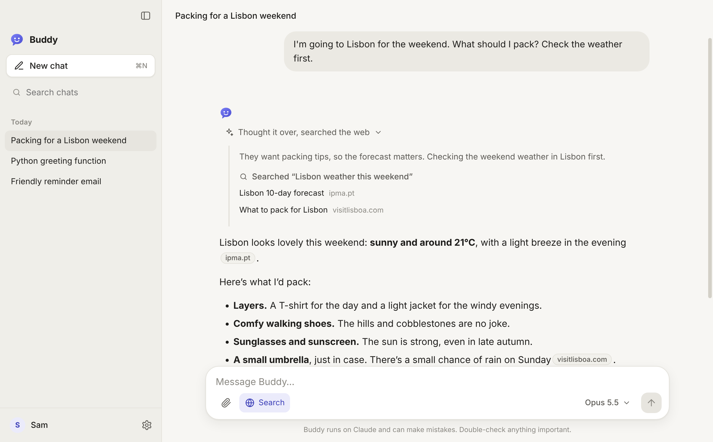

# Buddy

Your own Claude chat app for the Mac.

It looks and works a lot like the Claude app: you chat, replies stream in as they're written, it can search the web, read your files, and it keeps all your chats. It runs on your Mac and uses your own Anthropic API key.



## What it can do

- **Chat with Claude.** Pick Opus 5.5 (the default), Sonnet 5.5, Haiku 5.5 or Fable 5.2, and how hard it should think: Quick, Balanced or Deep.
- **Show its thinking.** Click "Thought for 6s" to see a short summary of how Claude worked it out.
- **Search the web.** Claude looks things up when it needs to and shows its sources. Turn it off with the Search button.
- **Read your files.** Drag in photos, screenshots, PDFs, or text and code files. You can paste images too.
- **Keep your chats.** Everything is saved on your Mac. Search, rename or delete chats from the sidebar.
- **Get to know you.** Tell it your name, a bit about you, and how you like answers (Settings → About you). You can even rename your assistant.
- **Pop up from anywhere.** Press ⌥ Space in any app to show or hide it.
- **Edit and retry.** Fix a message you already sent, or ask for a fresh answer.
- Light and dark mode, code highlighting with copy buttons, tables and more.

## Before you start

You need two things:

1. **Node.js** (free). Download the LTS version from [nodejs.org](https://nodejs.org) and install it. It's only used to build the app.
2. **An Anthropic API key.** Sign in at [platform.claude.com](https://platform.claude.com/settings/keys), add some credits under Billing, and create a key. API use is paid as you go and is separate from a Claude.ai subscription.

## Install

Open the **Terminal** app and run these one at a time:

```bash
git clone -b claude/wonderful-tesla-irl54a https://github.com/pradeepw1/Vibing.git Buddy
```

```bash
cd Buddy
```

```bash
./install.sh
```

The first run takes a few minutes. When it's done, Buddy is in your Applications folder and opens by itself. Paste your API key and start chatting.

To update later, run `git pull` and then `./install.sh` again from the same folder. Your chats and settings stay where they are.

### Or download the ready-made app (no Node.js needed)

GitHub builds and tests Buddy on a Mac every time the code changes.

1. Open the [Buddy Mac app builds](https://github.com/pradeepw1/Vibing/actions/workflows/buddy-mac.yml) page and click the newest run with a green check.
2. Under **Artifacts**, download **Buddy-for-Apple-chip-Macs** (or **Buddy-for-Intel-Macs** for an older Intel Mac). Unzip it until you see **Buddy**, and drag it into your Applications folder.
3. The first time you open it, macOS will say it can't check the app. That's because it isn't registered with Apple (that needs a paid developer account). Open **System Settings → Privacy & Security**, scroll down, and click **Open Anyway**.

## Handy shortcuts

| Keys | What it does |
| --- | --- |
| ⌥ Space | Show or hide Buddy from any app (change it in Settings) |
| ⌘ N | New chat |
| ⌘ K | Search your chats |
| ⌘ , | Settings |
| ⌘ \ | Show or hide the sidebar |
| Enter | Send (Shift + Enter for a new line) |
| Esc | Stop a reply |

## What it costs

Buddy itself is free. You pay Anthropic only for what you use:

- A typical message with **Opus 5.5** costs a few cents. Replies that search the web, long chats and big files cost more.
- **Haiku 5.5** is much cheaper and great for quick questions.
- Each **web search** adds about 1 cent.
- Hover over the model name under any reply to see how many tokens it used.

Tip: set a monthly spend limit in the Console so there are no surprises.

## Your privacy

- Chats and files are saved only on your Mac, in `~/Library/Application Support/Buddy`.
- Your API key is encrypted with your Mac's Keychain.
- Your messages go straight from your Mac to Anthropic to get replies, and nowhere else.

## If something goes wrong

- **"Buddy wants to use your confidential information stored in Buddy Safe Storage"**: that's the Keychain guarding your API key. Enter your Mac password and click **Always Allow**. It may ask again after you reinstall.
- **⌥ Space doesn't open Buddy**: another app (like Raycast or Alfred) may already use it. Pick a different shortcut in Settings → Quick open.
- **"Your API key didn't work"**: create a new key at platform.claude.com and paste it in Settings → API key.
- **"Your credit balance is too low" or "over your usage limit"**: add credits or raise your limit in the Console.
- **The installer says Node.js is missing**: install it from nodejs.org, then close and reopen Terminal.

## Try it without installing

To poke around or change the code, run it straight from the folder:

```bash
npm install
```

```bash
npm start
```

## Make it yours

- **Assistant's name, your info, reply style:** Settings → About you
- **Colors:** the top of `src/renderer/styles.css`
- **App name:** `productName` in `package.json` (then run `./install.sh` again)

## How it's built

- It's an [Electron](https://www.electronjs.org) app. `src/main` does the behind-the-scenes work: talking to Claude through the official Anthropic SDK, saving chats, and the Keychain. `src/renderer` is the chat window.
- Replies stream in live, with Claude's thinking summaries, web search and web fetch, and prompt caching turned on.
- If a model declines a request for safety reasons, the API can hand it to a backup model so you still get an answer.
- Chat history is only ever added to, never rewritten. That keeps Claude's saved reasoning valid and makes long chats cheaper thanks to caching.
- If the API ever rejects one of the newer options, Buddy quietly retries with a simpler request instead of failing.
- `test/` has an end-to-end test that drives the real app against a fake Claude API. To run it: `npm install --no-save playwright`, then `npm test` (on Linux, `xvfb-run -a npm test`).
