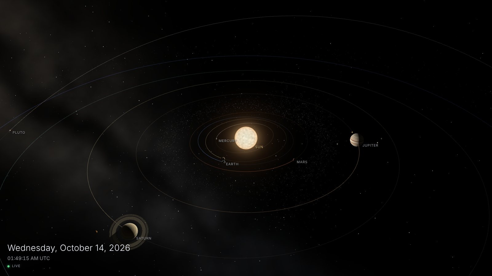
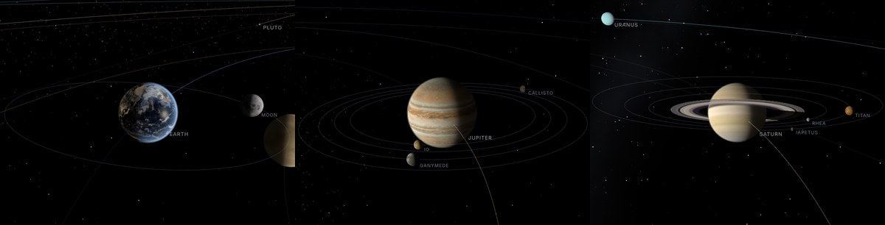
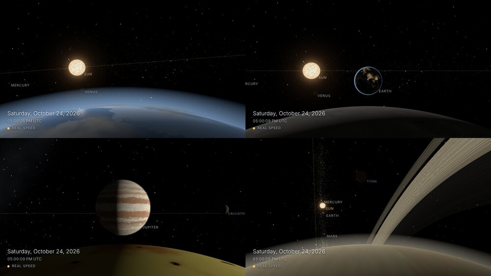

# Solar System Live

A live wallpaper of the solar system. Every planet and moon sits where it really is right now, and moves the way it really does.




It's one web page. It runs in any browser and works as a desktop wallpaper on Windows, macOS and Linux. It needs no internet connection and no server, so you can just open `dist/index.html`.

## What's real

| Thing | How real |
|---|---|
| Where the planets and Pluto are | Real, from [astronomy-engine](https://github.com/cosinekitty/astronomy) (within about 1 arcminute) |
| Earth's Moon | Real position, so the phase you see is tonight's phase. It wobbles (libration) like the real one |
| Jupiter's Io, Europa, Ganymede, Callisto | Real positions |
| Charon | Real: it always hangs over the same spot on Pluto, the same as in reality |
| Which way each planet faces and spins | Real, from the official figures for each body's axis and spin. The day side of Earth matches the actual time of day |
| Tilt of each planet and of Saturn's rings | Real. Saturn's rings open and close over its 29-year orbit |
| Shadows | Saturn's rings cast a shadow on Saturn and Saturn shades its rings, at the real angle |
| Other moons (Phobos, Titan, Triton, Uranus's moons...) | Real size of orbit, real period, real direction (Triton goes backwards). Where they are along their orbit is made up |
| Eclipses | Moons go dark in their planet's shadow: Io every 42 hours, our Moon (turning red) during real lunar eclipses |
| Asteroid belt, Trojans, Kuiper belt | Made-up rocks on real-looking orbits. They move the way real asteroids do, they leave the gaps that Jupiter's pull clears out (the Kirkwood gaps), and the Trojans stay 60° ahead of and behind Jupiter |
| Milky Way | Placed where the real one is in the sky. The stars themselves are made up |
| Nearest galaxies | The Large and Small Magellanic Clouds, the Sagittarius Dwarf, Andromeda (with its two small companions) and Triangulum, at their real places in the sky, real sizes and real tilt, each with its name and distance. Their look is painted in code |
| Famous galaxies far away | Bode's Galaxy, the Cigar, Centaurus A, the Sculptor, Pinwheel, Whirlpool, Sombrero, M87, NGC 1300, the Antennae and the Cartwheel: 11 to 500 million light-years out, at their real places and real sizes. Their shapes (a ring, a collision, a dust lane, a jet, gas blown out of a starburst) and colours follow the real ones; the individual stars are made up |
| Black holes | Sagittarius A* (the middle of the Milky Way), Cygnus X-1 and M87*, at their real places and distances. **Drawn far bigger than they are** (from about 170,000 times for M87\* to billions of times for Cygnus X-1), or you'd never see them. The bending of light around them follows the real rule for light past a black hole. The disc, its colours and the star crowds round them are made up |
| Planets round other stars | 39 well-known systems (Proxima Centauri, TRAPPIST-1, 51 Pegasi, HR 8799, Kepler-452...), 107 planets, at their real places in the sky and real distances. Each planet's year and distance from its star come from the Open Exoplanet Catalogue, and so do its size and temperature where the catalogue has them; where it doesn't they are worked out, and the label says "about". **What they look like is made up**: nobody has seen them |
| Sizes and distances | **Squashed** so everything fits on one screen. Directions are never changed, only distances, so line-ups and phases stay true |
| Planet surfaces | Real maps made from pictures taken by space probes (see Credits): Earth's land, sea floor and city lights, the Moon's craters, Mars, Jupiter's storms, Saturn and the true gaps in its rings, Io's volcanoes, Pluto's heart, and so on, down to the small moons. Venus and Uranus are mostly drawn by Solar System Scope, because their real faces show little. Where no probe took a picture (half of Triton, the north of Uranus's moons) the map is filled in with a blend of what's around it, and some maps that were only taken in grey are tinted with the colour the body is described as having. The body you are looking at has a surface painted in code until its map arrives, and any body with no map keeps that painted look. You can turn the painted look back on in the menu |

The clock in the corner is your local time. Speed it up to watch the inner planets lap the outer ones, Moon phases come and go, and Saturn's rings tilt.

## The sky from a planet



Click any planet or moon (or its name) to see the sky from there. You hover just above the ground with the horizon at the bottom of the screen. On a planet the Sun sits low over the horizon; on a moon you face the planet it goes round, rising over the edge (Earth from the Moon, Jupiter from Io). Drag to look around, scroll (or pinch) to go higher or lower, and press <kbd>Esc</kbd> or **Back** to return. Click another body in the sky to hop over to it.

Everything in that sky is in the direction it really is from where you stand, with its real phase. From Earth in late October 2026 you'll see Venus as a dark sliver next to the Sun, because it's passing between us and the Sun. Speed time up and Mars loops backwards across the sky around its opposition.

Discs are drawn bigger than real so you can see them. The Sun and the Moon both look about 5½ degrees wide (really half a degree). Small ones grow the most, and ones that are already big hardly grow at all (Jupiter seen from Io is its real size, 19 degrees across). A bigger real disc always stays bigger, so the Sun and the Moon still match from Earth. Where two discs come close, the gap between them is stretched just enough that they only touch when the real ones do, as seen from that planet or moon. So eclipses, transits and the Moon passing over a planet happen on their real dates and only then. The Moon covers the Sun from Earth on 2 August 2027, and the tests check that it doesn't at any other new moon that year, and that from Earth no two discs touch when they shouldn't at any time in 2026. From Jupiter's moons, where Jupiter fills a big part of the sky, it's right almost all of the time.

Jupiter's moons are shown where they were when their light left (about 40 minutes earlier from Earth), so they cross Jupiter at the times listed in sky almanacs.

The nearest galaxies are out there too, in the same places from every planet because they're so far away. Andromeda and Triangulum are in the northern autumn sky; the two Magellanic Clouds sit near the south pole of the sky, so they show up behind the planets when you look down on the solar system.

## Out to the galaxies

Click a galaxy's name and you leave the solar system: the view turns towards it, then flies out across the gap (2.5 million light-years to Andromeda) and circles it, seen from its far side with the Milky Way in the distance behind it. Every galaxy is a 3D cloud of stars at its real distance and direction from the Sun, tilted the way it really is towards us: Andromeda's tightly wound arms and its ring of new stars, Triangulum's loose arms and the pink NGC 604, the Large Magellanic Cloud's off-centre bar and the Tarantula Nebula, the Small Magellanic Cloud stretched out almost straight towards us, and the Sagittarius Dwarf being pulled apart below the Milky Way. The Milky Way is there too, with its bar and four arms, and the Sun marked on the inner edge of the Orion spur.

### Black holes

Three real black holes are out there too. Click a name (or pick one from the menu) and you fly to a spot just above its disc of glowing gas.

- **Sagittarius A\*** sits in the middle of the Milky Way, 26,700 light-years away, with about 4 million suns' worth of mass.
- **Cygnus X-1** was the first black hole ever found (about 21 suns), 7,200 light-years away. A blue giant star circles next to it, and you can see the gas it pulls off.
- **M87\*** is the one in the first photograph of a black hole (2019), in the galaxy M87, 53.5 million light-years away.

Their places in the sky and their distances are real, and M87\*'s disc is tilted the way the real one is. Everything else is made up or stretched: a real black hole is only a speck, so each is drawn hundreds of thousands to billions of times bigger, and the colours, streaks and clumps of the disc are invented. What's real is the bending of light: every pixel follows its own ray of light round the hole, so stars are stretched into arcs, the middle is black, and the back of the disc is seen bent over the top and underneath. The side of the disc that's turning towards you is brighter and bluer. It's the heaviest drawing in the app, so if your graphics chip can't keep up, the picture near a black hole is drawn a little softer.

Further out are eleven famous galaxies, up to half a billion light-years away: the Whirlpool with its small companion, the Sombrero with its dark dust lane, Centaurus A cut by dust, the Cigar and the Sculptor Galaxy with red gas blown out of their middles, the Pinwheel, Bode's Galaxy, a barred spiral (NGC 1300), the Antennae mid-collision with their long tails, the Cartwheel's huge blue ring, and M87 with its blue jet. They're in the same menu.

### Other stars and their planets

Pick one from the menu ("Fly to a star with planets"), click its name on the sky (the best-known ones are labelled), or use `?view=galaxy-proxima`. You fly out of the solar system to the star, then sink down into its system: the star, its planets going round (the inner ones faster than the outer ones, with the speeds squeezed so the far ones still move; each label has the real year), and a green band for the habitable zone (where water could stay liquid). Click a planet's name to fly to it and see its lit side; click the star or empty space to see them all again. Esc flies you home.

- **Real:** where each star is and how far; the star's temperature and size; each planet's year and distance from its star (the distances are squashed, in the right order), and its size and heat where the catalogue has them. Where it doesn't, they are worked out (from the planet's weight, or from its star and its distance) and say "about". The data is in `src/exoplanet-data.js`, built by `tools/make-exoplanets.mjs` from the [Open Exoplanet Catalogue](https://github.com/OpenExoplanetCatalogue/open_exoplanet_catalogue) (MIT licence), which collects what NASA's Exoplanet Archive and the papers report. A few gaps are filled in by hand from the papers (marked in the tool).
- **Made up:** what each world looks like (the kind is picked from its size and heat: a rocky world with seas, a banded gas giant, a smooth ice giant, a lava world, a frozen rock), and where it is on its orbit.
- Where a planet's size isn't measured, it's worked out from its weight and shown as an estimate in the data; a few planets that not everyone agrees on are marked "disputed" in their label.

Drag to look round, scroll to zoom. Out there, names show how far each galaxy is from where you are; click one to fly over to it, or click the Milky Way (or press Back or <kbd>Esc</kbd>) to fly home. The stars in these galaxies are made up; their sizes, tilts, bars, arms and positions come from published measurements.

### The Gate

A made-up doorway, and the strangest place here. It's in the menu under "A made-up place" (or `?view=galaxy-gate`, or click its name on the sky). It sits in the direction the 1977 "Wow!" radio signal came from, because that's the best-known thing nobody has explained; how far away it is, is only a guess, and its label says "Made up".

Fly up to it and you sink through: a long round hall of light that never ends. Every so often a doorway rises out of the dark; go through and the whole place changes (its colours, its number of sides, and what kind of light it gives off: rushing streaks, a neon lattice with pulses running down it, or a slow turn). Drag to look round, scroll to go faster or slower, <kbd>Esc</kbd> to go home. **Be warned:** it is fast, bright light, with a quick flash at every doorway. With slow camera drift off (or when your system asks for less motion), everything moves much more slowly and the flash is weaker.

None of it is real; the picture is drawn by the computer from a few formulas (`src/gate.js`, `src/elsewhere.js`).

## Strange sightings

Every few minutes, something drifts through the view: a ship, a craft, a thing in the sky that shouldn't be there. They take a minute or two, never rush, and leave without a trace. Turn them off with **Strange sightings** in the settings (or `?strange=0`), or press **Show me one now** in the panel. If your system asks for reduced motion, none come by themselves, but the button still works.

**All of them are made up, apart from the two real Voyager probes.** When one ends, a note in the corner says what it was and that it was invented. Each one is drawn from scratch in code (no models or pictures), in `src/oddities/`.

- **Unidentified craft** (`ufo.js`): *The Count*, a black ring far bigger than any ship, seen by the stars it hides, whose seams light one at a time as it turns to face you. *The Assembly*, eighty-nine cold lights in a lattice too exact to be a flock, which stop together and all turn to look at you. *The Needle*, a shaft hundreds of times longer than it is wide, with a pulse of light running along it every few seconds, swinging round until it points at you.
- **Ships** (`ships.js`): a generation ship turning its drums for a crew asleep for centuries, a line of shuttles flying in perfect order, a torn-open wreck with one beacon still calling, and the real *Voyager 1* and *Voyager 2*, shown as small models (not at their true place in the sky).
- **Odd sky** (`phenomena.js`): *The Seam*, a crack in the sky with a wrong sky behind it. *The Echo*, a ring of light spreading from a place with no star (a nod to real light echoes, like V838 Monocerotis). *The Primes*, rings of light in groups of 2, 3, 5, 7, 11. *The Curtains*, aurora with no planet under it. *The Dimming*, dark pieces crossing a star and fitting together over it (a nod to Tabby's Star).

They show up in the Sun-and-planets views and from the ground. They're placed a little off the middle of the view, never behind a planet, and never switch on while the camera is moving between views.

## Use it as your wallpaper

The files you need are all in `dist/`: `index.html`, `solar.js`, `LivelyProperties.json`, `CREDITS.txt` and the `maps` folder (the real planet maps, about 16 MB; without it you get painted planets). Copy that folder anywhere.

**Windows, with [Lively Wallpaper](https://www.rocksdanister.com/lively/) (free):** click *Add wallpaper*, pick `dist/index.html`. The settings (speed, view, names...) show up in Lively's customise panel. A small settings button also shows in the corner of the picture; untick **Show settings button** to hide it.

**Windows, with Wallpaper Engine:** open the wallpaper editor, create a wallpaper from `dist/index.html`. Click the small button in the top right of the wallpaper to change settings. They're saved.

**macOS, with [Plash](https://sindresorhus.com/plash) (free):** add a website and point it at the `index.html` file.

**Linux:** KDE Plasma and some other desktops have "web page" wallpaper plugins. Point one at `index.html`.

**Phones:** not yet. That needs a native app (see Next).

For wallpaper use, add `?wallpaper` to the address (`index.html?wallpaper`). It hides the settings button and runs at 30 frames a second to save power.

## Settings

Click the button in the top right, or add them to the address, like `index.html?speed=day&view=earth`.

| Setting | Values | Default |
|---|---|---|
| `speed` | `live`, `minute`, `hour`, `day`, `week`, `month`, `year` (how much time passes each second) | `live` |
| `view` | Look at: `system`, `middle`, `inner`, `sun`, or a planet (`mercury` ... `pluto`). Look from: `from-earth`, `from-mars` ... any planet or moon, like `from-moon` or `from-io`. Fly to a galaxy: `galaxy-m31`, `galaxy-m33`, `galaxy-lmc`, `galaxy-smc`, `galaxy-sgr`, or one of the far ones (`galaxy-m51`, `galaxy-m81`, `galaxy-m82`, `galaxy-cena`, `galaxy-ngc253`, `galaxy-m101`, `galaxy-m104`, `galaxy-m87`, `galaxy-ngc1300`, `galaxy-antennae`, `galaxy-cartwheel`). Fly to a black hole: `galaxy-sgra`, `galaxy-cygx1`, `galaxy-m87bh`. The made-up Gate: `galaxy-gate` | `middle` |
| `reverse` | `1` to run time backwards | `0` |
| `date` | any date, like `2033-05-01` or `1969-07-20T20:17Z`. Start there instead of now | now |
| `labels`, `orbits`, `belts`, `clock`, `drift`, `strange` | `0` or `1` (`strange` is the sightings above) | all `1` |
| `photos` | `0` for painted planets only (the menu's **Real maps** box). Good for a slow computer or a small download | `1` |
| `fps` | frames per second, 5 to 240 | 60 |
| `ui` | `0` hides the settings button | `1` |
| `wallpaper` | shorthand for `ui=0&fps=30` | |

Keys: <kbd>Space</kbd> pause, <kbd>←</kbd> <kbd>→</kbd> slower/faster, <kbd>R</kbd> backwards, <kbd>N</kbd> back to now, <kbd>L</kbd> names, <kbd>O</kbd> orbits, <kbd>H</kbd> hide everything, <kbd>F</kbd> full screen, <kbd>1</kbd>-<kbd>9</kbd> look at a planet, <kbd>Shift</kbd>+<kbd>1</kbd>-<kbd>9</kbd> look from it, <kbd>Enter</kbd> look from the planet you're looking at, <kbd>Esc</kbd> / <kbd>B</kbd> / <kbd>Backspace</kbd> back, <kbd>0</kbd> overview.

Drag to turn the view, scroll to zoom, click a planet or moon to see the sky from there.

A view you reach by clicking isn't saved, so a stray click on your desktop won't change the wallpaper after a restart. Pick it in the settings panel (or the address) to keep it. In Lively, the settings have a **Look at** list and a **Look from** list; set Look from to *Nothing* to go back to the Look at view.

Time can run from 1600 to 2400. Outside that, the models for the moons and Pluto get shaky, so it stops.

## Changing it

You need [Node.js](https://nodejs.org) 18 or newer.

```sh
cd solar-wallpaper
npm install
npm run build      # rebuilds dist/solar.js from src/
npm test           # checks positions against real events (equinox, Mars opposition, eclipses, full moon...), and the data and shapes behind the galaxies, black holes, sightings, the Gate and the maps
npm run textures   # then open tools/textures.html to see every painted surface flat
npm run maps       # rebuilds dist/maps/ from the original NASA and USGS maps (see below)
```

`dist/solar.js` and `dist/maps/` are committed, so the wallpaper works without building. Rebuild `solar.js` after you change anything in `src/`, and also after you rebuild the maps: `solar.js` has the list of maps baked in.

### How the maps are made

The real maps in `dist/maps/` come from `tools/make-maps.py`. You only need to run it to change the maps.

1. You need Python 3.9 or newer, and `pip install pillow numpy` (Pillow with WebP, which the usual download has).
2. `python3 tools/make-maps.py fetch` downloads the original maps (about 3.5 GB: NASA, USGS and Solar System Scope; a few minutes on a fast line) into `tools/maps-src/`, which git ignores. It shrinks each one to at most 8192 pixels wide and throws the huge original away. Some hosts (NASA's own site, Solar System Scope's) can be blocked on some networks; the tool then tries a public copy of the same file on GitHub.
3. `python3 tools/make-maps.py build` (or `npm run maps`) turns those into the files the page loads. Then run `npm run build`, so the page learns which maps exist. Add `--only moon,mars` to redo a few, and `--preview some/folder` to also save each finished map as a PNG to look at.

For each map it makes two sizes: **lite** (2048 pixels wide for Earth, the Moon, Mars, Jupiter and Saturn; 1024 for the rest; 3 MB in all) and **sharp** (4096 for Earth, its clouds, the Moon, Mars, Jupiter and Saturn; 2048 for most others; 9 MB in all). The page loads every lite map after its first picture, and a sharp one only for the body you are looking at closely or standing on, and lets it go again afterwards. Each is a small WebP picture, written as text inside a plain script (`dist/maps/moon.sharp.js` sets `window.__maps["moon.sharp"]` to a `data:` address), because a page opened straight from disk can't read picture files next to it, but it can run scripts and read `data:` addresses.

On the way it cleans up what the originals need:

- **Grey maps are tinted** (Europa, Callisto, Pluto, Charon, Phobos, Deimos, Rhea, Iapetus, Titan and Uranus's moons): the darker a spot is, the more brown or cream it gets, going by what the body is described as looking like. Mercury's and Triton's colours were stretched to show different rocks and ices, so they are turned down to a plain grey-brown and a pale cream. Mars and Jupiter are warmed a little.
- **Gaps are filled**: where no probe took a picture the original is pure black. Those parts are filled with a blur of what is around them, plus detail borrowed from elsewhere on the same map, so no black patch shows.
- **The edges meet**: the map's left and right edges are made to match at the 180 degree line (no thin line there), and the rows near each pole are blended so the poles are a clean point, not a pinch.
- **Earth's night lights and water** are packed into one picture (red is city lights, green is sea and lakes, from Natural Earth's outlines), the way the page's shader wants them. Saturn's rings are one row of pixels from the real ring picture.

The built files are in git, but the originals are not.

| File | What it does |
|---|---|
| `src/ephemeris.js` | Where everything is and which way it faces, and how sizes and distances are squashed (`SCALE`) |
| `src/bodies.js` | Sizes, periods and colours of the Sun, planets and moons |
| `src/system.js` | Builds the planets, moons, rings and orbit lines, and moves them every frame |
| `src/surfaces.js` | Paints each planet's surface in code (the stand-in until the real maps arrive, and the fallback). `src/land.js` holds the coastlines |
| `src/paint-worker.js`, `src/painter.js` | Do that painting in the background, so the animation never stutters |
| `src/maps.js` | Loads the real maps from `dist/maps/` after the first picture, nearest planet first, without stuttering, and frees the sharp ones when you look away |
| `dist/maps/` | The real maps, one script per map and size (`earth.lite.js`, `earth.sharp.js`...), and `manifest.json` listing them |
| `tools/make-maps.py` | Downloads the original maps and builds `dist/maps/` from them |
| `src/shaders.js` | Lighting, night-side city lights, ring shadows, the Sun's surface, orbit trails, asteroids |
| `src/belts.js`, `src/sky.js` | Asteroids and the Kuiper belt; stars and the Milky Way |
| `src/galaxies.js` | The nearest galaxies on the sky: where they are, how big, and how they're painted |
| `src/localgroup.js` | Out among the galaxies: each one (and the Milky Way) as a 3D cloud of stars, and the flights between them |
| `src/clouds.js` | How each kind of galaxy's stars are laid out: spirals, bars, ellipticals, rings, collisions |
| `src/exosystem.js`, `src/exoshaders.js` | A visit to another star's planets: the star, orbits, habitable zone, and each planet drawn from noise by its kind |
| `src/exoplanet-data.js` | The planets round other stars, made by `tools/make-exoplanets.mjs` |
| `src/blackholes.js` | The black holes: where they are, how big they're drawn, how their discs are tilted. The light-bending itself is in `src/shaders.js` |
| `src/oddities/` | The strange sightings: `stage.js` decides when and where one appears; `ufo.js`, `ships.js` and `phenomena.js` draw them |
| `src/noise.js` | The noise functions the painted surfaces, the galaxies and the Gate are made from |
| `src/gate.js`, `src/elsewhere.js` | The Gate (made up) and the endless hall beyond it, with its doorways and changing places |
| `src/pov.js`, `src/povcam.js` | The sky as seen from a planet or moon, and the camera that hovers over its ground |
| `src/main.js`, `src/ui.js`, `src/settings.js` | The clock, camera, settings panel and wallpaper-app hooks |
| `tools/make-land.mjs` | Rebuilds `src/land.js` from Natural Earth map data |
| `tools/build.mjs` | Builds `dist/solar.js`, and writes `dist/LivelyProperties.json` from the same lists the page uses |

## Credits

The planets round other stars come from the [Open Exoplanet Catalogue](https://github.com/OpenExoplanetCatalogue/open_exoplanet_catalogue) (Hanno Rein and contributors, MIT licence; [Rein 2012](http://arxiv.org/abs/1211.7121)), which gathers results from NASA's Exoplanet Archive and the published papers. [three.js](https://threejs.org) (MIT) draws it. The simplex noise in the shaders is by Ian McEwan (Ashima Arts, Copyright (C) 2011) and Stefan Gustavson (MIT), the hash functions in the sky scenes are "Hash without Sine" by David Hoskins (MIT), and the blackbody colour curve is a fit published by Tanner Helland. The licence texts are in `dist/CREDITS.txt`. [astronomy-engine](https://github.com/cosinekitty/astronomy) by Don Cross (MIT) works out the positions. The painted stand-in for Earth's coastlines comes from [Natural Earth](https://www.naturalearthdata.com) (public domain) via [world-atlas](https://github.com/topojson/world-atlas).

**The real maps.** Every picture comes from a space mission, and the maps were joined, cleaned, resized and in some cases tinted or filled in for this project (see "How the maps are made"). NASA and USGS maps are public domain, and NASA should be thanked as their source; no NASA endorsement is meant or implied.

| Map | Made from | Licence |
|---|---|---|
| Earth (land and sea floor) | [NASA Earth Observatory](https://earthobservatory.nasa.gov/features/BlueMarble), Blue Marble Next Generation with topography and bathymetry, December 2004 | Public domain |
| Earth's city lights and clouds | Solar System Scope, from NASA pictures | CC BY 4.0 |
| Earth's water mask | [Natural Earth](https://www.naturalearthdata.com) land and lake outlines (1:10m) | Public domain |
| Moon, Venus (cloud tops), Jupiter, Saturn, Saturn's rings, Uranus, Neptune | Solar System Scope, based on NASA imagery (Moon: LRO and Kaguya; Jupiter and Saturn: Cassini). Venus and Uranus are mostly drawn by Solar System Scope, not photographed | CC BY 4.0 |
| Mars | USGS Astrogeology Science Center, Viking colour mosaic (925 m) | Public domain |
| Mercury | USGS Astrogeology Science Center, from MESSENGER pictures (NASA, Johns Hopkins APL, Carnegie Institution) | Public domain |
| Pluto, Charon | USGS Astrogeology Science Center, from New Horizons pictures (NASA, Johns Hopkins APL, Southwest Research Institute). Tinted here | Public domain |
| Io, Europa, Ganymede, Callisto | USGS Astrogeology Science Center, from Galileo and Voyager pictures. Europa and Callisto tinted here | Public domain |
| Titan | USGS Astrogeology Science Center, from Cassini pictures (infrared, so the colour is invented to match how Titan looks from space) | Public domain |
| Triton | USGS Astrogeology Science Center, mosaic by Paul Schenk (Lunar and Planetary Institute), from Voyager 2 pictures. Colour turned down, unmapped north filled in | Public domain |
| Phobos | USGS Astrogeology Science Center, from Viking pictures (control by DLR). Tinted here | Public domain |
| Deimos | [Celestia project](https://github.com/CelestiaProject/CelestiaContent), from Philip Stooke's maps in NASA's Planetary Data System. Tinted here | CC0 |
| Rhea, Iapetus | USGS Astrogeology Science Center, from Cassini and Voyager pictures. Tinted here | Public domain |
| Miranda, Ariel, Umbriel, Titania, Oberon | [NASA 3D Resources](https://github.com/nasa/NASA-3D-Resources), from Voyager 2 pictures. Tinted here, unmapped north filled in | Public domain |

The Solar System Scope maps: *Textures by [Solar System Scope](https://www.solarsystemscope.com/textures/), licensed [CC BY 4.0](https://creativecommons.org/licenses/by/4.0/), based on NASA imagery. Changed here: resized, joined at the edges, recoloured a little and packed into other files.*

## Next

- Real bright stars and constellations, from a star catalogue
- The Moon's shadow on Earth during a solar eclipse, and Jupiter's moons' shadows on Jupiter
- Real starting positions for the smaller moons (from JPL's mean orbital elements)
- Comets, and real positions for spacecraft like Voyager and JWST
- Better filling of the parts no probe photographed: on Ganymede, Europa, Callisto and Mercury, orbiting over the poles shows grey patches with straight edges where the map was filled in
- Bumps and shadows from real heights (the Moon's craters, Mars's volcanoes) so relief changes with the light
- An 8192-pixel size for the Moon, Earth and Mars when you zoom right in
- An Android live wallpaper version
